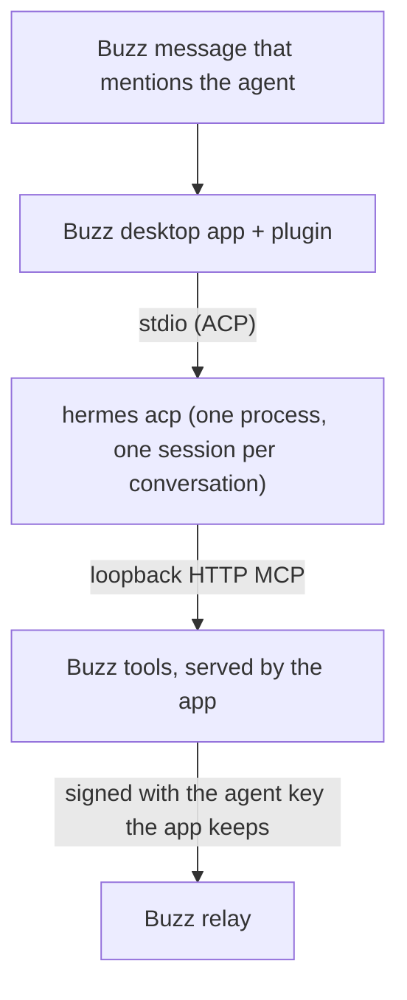

# buzz-plugin-hermes

Run [Hermes Agent](https://github.com/NousResearch/hermes-agent) agents in
the Buzz desktop app. The plugin `sagmans.hermes` adds the agent type
"Hermes". Each conversation of a Hermes agent is one Hermes ACP session on
your computer, with the provider and model that Hermes is set up with.

## What it does



- The turn logic is the Buzz app's own Goose runtime and shared ACP client,
  bundled unchanged. A Hermes agent therefore acts as a Goose agent does:
  the same sessions, the same per-thread or per-channel scope, the same
  Stop, and the same reply rules.
- Hermes answers with the Buzz tools (`send`, `read`, memory, canvas and
  others). The app serves them to each session over loopback HTTP MCP. The
  agent key stays in the app; Hermes never gets it.
- Only the owner, or an identity the owner delegated to, can start a turn
  with a mention. Hermes runs commands as you, so other mentions are ignored.
- The New agent dialog and the Settings tab list the models that Hermes
  offers. "Default" keeps the model of your Hermes config.
- These views use the app's own model picker, instructions field and
  settings rows, so they look as they do for the app's own agents.

## Requirements

- The Buzz desktop app, version 0.7.0-preview.240.1 (see "Compatibility").
- Hermes Agent 0.22.1 or newer with its ACP extra, on `PATH` as `hermes`.
  `hermes acp --check` must pass.
- A provider and model set up in Hermes (`hermes setup`).
- The Hermes gateway must run. Hermes routes ACP sessions through it; with
  no gateway, a new session fails with "Gateway inaccessible". Start it
  with `hermes gateway start` (or `hermes gateway run` in a terminal).

## Install

1. Build the plugin (see "Build"). The output is `dist/manifest.json` and
   `dist/plugin.js`.
2. In the Buzz desktop app, install the plugin from the `dist/` folder.
3. Create an agent of the type "Hermes". Pick a model, or keep "Hermes
   default", and write its instructions.
4. Mention the agent in a channel.

The plugin asks for these host grants (`plugin/manifest.json`):

| Grant | Why |
| --- | --- |
| Process `hermes acp` | Starts Hermes. No other program and no other arguments. |
| `mcp` | Serves the Buzz tools to Hermes on a loopback port, with a token. |
| `files` | Lets the Buzz tools attach files from the agent's workspace. |

## Settings

| Setting | Effect |
| --- | --- |
| Model | A Hermes model id, such as `anthropic:claude-sonnet-5-5`. Empty keeps Hermes' default. |
| Instructions | Added to the Buzz system prompt of each new session. |
| Workspace | The folder Hermes works in: an absolute path or `~/…`. |
| Sessions | One session per thread, or one per channel. |

A changed setting opens a new session at the next idle turn.

## Limits

- Hermes runs tools without approval. The shared ACP client answers each
  permission request with "allow", as it does for Goose. Give the agent a
  workspace you trust it with.
- Hermes has no thinking-level picker in ACP, so the plugin shows none.
- Hermes has no system-prompt or steer extension in ACP. The Buzz system
  prompt goes at the head of the first prompt of a session, and a message
  that comes during a turn runs as the next turn.
- Each session gets the Buzz tools. The Hermes gateway, not the plugin,
  decides which MCP servers from your Hermes config a session also gets.
  Since Hermes 0.22.1, `HERMES_ACP_SKIP_CONFIGURED_MCP` has no effect.
- Hermes 0.22.1 does not advertise HTTP MCP in its ACP `initialize` answer,
  but it accepts HTTP MCP servers. The plugin adds the missing flag to that
  one answer (`src/hermes.ts`, `hermesSpawn`). The smoke run proves that
  Hermes reaches the Buzz tools.
- The Hermes gateway connects to the Buzz tools again for a turn. The
  app's host normally lets one MCP client use a session's token. The plugin
  asks the host for a shared MCP session, so each client that has the token
  can connect (`src/index.ts`, `sharedMcpHost`). The token stays on loopback,
  and it is valid only for one session. Hermes keeps it only in memory.
- No Activity tab and no synced settings: these are app modules, not plugin
  API.
- The Settings tab does not warn about unsaved changes when you leave it.
  The plugin API does not give that part of the app to plugins.

## Compatibility

The plugin bundles modules of the Buzz app at one revision
(`BUZZ_APP_REV` in `scripts/build-plugin.mjs`): `0b2dfbf98`, the revision
of Buzz Desktop 0.7.0-preview.240.1. A new app release can change these
modules. Before you use the plugin with a newer app, move the pin to that
release, then build and run `scripts/check`.

## Build

You need Node.js 24 or newer and a buzz-app clone at the pinned revision.
The build uses the clone's Vite and TypeScript. This repository installs no
packages of its own.

```sh
git clone https://github.com/block/buzz-app.git <clone>
git -C <clone> checkout 0b2dfbf98
(cd <clone> && bin/pnpm install --frozen-lockfile --ignore-scripts)
scripts/link-toolchain <clone>      # makes the gitignored buzz-app link
node scripts/build-plugin.mjs       # type check, then dist/
```

The build fails when the clone is at another revision, has local edits
under `src/`, or when the bundle would hold a module that must stay the
app's own (a React renderer, Tauri, the agent service or identity code).
React itself comes from the app at run time (`src/react-host.ts`).

## Checks

Run `scripts/setup-hooks` once after you clone. Install the tools in
`mise.toml` (`mise install`), plus `gitleaks`, `shellcheck`, `lizard`,
`semgrep` and `trivy`.

- `scripts/check --quick`: syntax, manifest grant, shell lint, private-data
  guard. The pre-commit hook runs it.
- `scripts/check`: all of the above, then Markdown lint, complexity,
  semgrep, trivy, the build and the smoke run. The pre-push hook runs it on
  each pushed commit.
- `node smoke/run.mjs`: loads the built plugin outside the app, with real
  `hermes acp`. It reads the models, then runs one turn that must answer
  through the Buzz `send` tool. `--model <id>` also proves the model
  switch. `--skip-turn` makes no model call.

The smoke run uses your own Hermes setup, so it makes one short model call
on your provider. It writes only to a temporary folder and publishes
nothing: its agent handle keeps events in memory.

Never use `--no-verify`.

## License

Apache License 2.0. See `LICENSE` and `NOTICE`.
