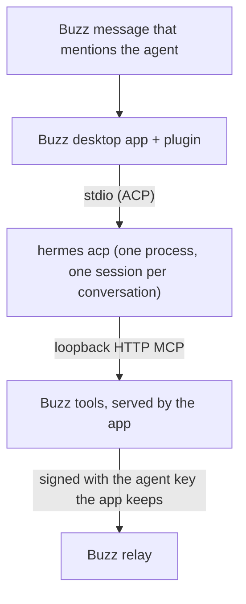

# buzz-plugin-hermes

Run [Hermes Agent](https://github.com/NousResearch/hermes-agent) agents in
the Buzz desktop app. The plugin `sagmans.hermes` adds the agent type
"Hermes". Each conversation of a Hermes agent is one Hermes ACP session on
your computer, with the provider and model that Hermes is set up with.

## What it does



- The turn logic is the Buzz app's own Goose runtime and shared ACP client,
  bundled unchanged. A Hermes agent therefore acts as a Goose agent does:
  the same sessions, the same per-thread or per-channel scope, the same
  Stop, and the same reply rules.
- Hermes answers with the Buzz tools (`send`, `read`, memory, canvas and
  others). The app serves them to each session over loopback HTTP MCP. The
  agent key stays in the app; Hermes never gets it.
- Only the owner, or an identity the owner delegated to, can start a turn
  with a mention. Hermes runs commands as you, so other mentions are ignored.
- The New agent dialog and the Settings tab list the models that Hermes
  offers. "Default" keeps the model of your Hermes config.
- These views use the app's own model picker, instructions field and
  settings rows, so they look as they do for the app's own agents.
- You can pick another model for one message, as on the app's own agents.
  The next message goes back to the agent's model.
- The agent's settings sync across your devices, and a community's
  repositories folder reaches the agent, as for the app's own agents.
- The Activity tab lists the agent's sessions. A transcript shows its prompts,
  steers, tool calls and replies, with Markdown layout. It reads them from
  Hermes first, as the app's Goose agents read theirs (see "Activity record").
- The app's token view shows what each turn used.
- The app's provider row and dialog show whether Hermes is installed, its
  version, whether a gateway answers, and its models. "Check again" reads them
  again. The dialog shows; it never starts a gateway or changes your Hermes
  setup.

## Requirements

- The Buzz desktop app, version 0.7.0-preview.243.1 (see "Compatibility").
- Hermes Agent 0.22.1 or newer with its ACP extra, on `PATH` as `hermes`.
  `hermes acp --check` must pass.
- A provider and model set up in Hermes (`hermes setup`).
- The Hermes gateway must run. Hermes routes ACP sessions through it; with
  no gateway, a new session fails with "Gateway inaccessible". Hermes 0.22.3
  and newer starts the gateway when a session needs it. With an older Hermes,
  start it with `hermes gateway start` (or `hermes gateway run` in a
  terminal).

## Install

1. Build the plugin (see "Build"). The output is `dist/manifest.json` and
   `dist/plugin.js`.
2. In the Buzz desktop app, install the plugin from the `dist/` folder.
3. Create an agent of the type "Hermes". Pick a model, or keep "Hermes
   default", and write its instructions.
4. Mention the agent in a channel.

The plugin asks for these host grants (`plugin/manifest.json`):

| Grant | Why |
| --- | --- |
| Process `hermes acp` | Starts Hermes. No other program and no other arguments. |
| `mcp` | Serves the Buzz tools to Hermes on a loopback port, with a token. |
| `files` | Lets the Buzz tools attach files from the agent's workspace, and lets the provider check read the state of the Hermes gateway (`~/.hermes/gateway_state.json`, two fields only). |

## Settings

| Setting | Effect |
| --- | --- |
| Model | A Hermes model id, such as `anthropic:claude-sonnet-5-5`. Empty keeps Hermes' default. |
| Instructions | Added to the Buzz system prompt of each new session. |
| Workspace | The folder Hermes works in: an absolute path or `~/…`. |
| Sessions | One session per thread, or one per channel. |

A changed setting opens a new session at the next idle turn.

## Activity record

A transcript reads its session from Hermes first, as the app's Goose agents do.
A short-lived `hermes acp` process replays the session (`session/load`), with a
timeout, and stops after the read. It goes on no record, and no text is cut. A
transcript shows the last 50 turns, says when older turns exist, and joins up
to 10 sessions of one conversation.

The plugin also writes a record while a turn runs: the messages between the app
and Hermes, as the app's own agents' transcripts show them. The tab shows the
record for the session that runs now, which updates live, and for a session
whose read fails or that Hermes no longer has. A failed read shows an alert
above the record. A turn read from Hermes takes its times, its end and its
steers from the record. The app's token view reads only the record.

- It holds **private data**: prompts with chat text and tool calls with what
  the agent read and wrote.
- It stays on this computer, in the app's agent storage. The plugin never
  sends it anywhere and does not write it to a file.
- It is bounded: the last 50 turns of each conversation, about 1 MB for each
  agent, with long text cut. The oldest turns go first.
- It holds no agent key and no MCP token: requests that carry credentials are
  not recorded.
- It stays after you remove an agent, until the app deletes its storage.
- The plugin also logs each session's id, conversation and workspace in the
  app's local storage, so that the tab can read it. The log holds no chat text.

## Limits

- Buzz draws icons only for its bundled plugins, so this plugin adds its own to
  its row and details panel in Settings, by editing that page. The build checks
  the page at the pinned app revision. If a newer app changes the page, the app's
  generic icon comes back; nothing else breaks.
- Hermes runs tools without approval. The shared ACP client answers each
  permission request with "allow", as it does for Goose. Give the agent a
  workspace you trust it with.
- No tool hooks. The app's `beforeTool` and `afterTool` hooks can block or
  change a tool call, and Hermes offers no ACP path for that. Its hooks are
  shell hooks and plugins in the Hermes config (`agent/shell_hooks.py`,
  `hermes_cli/plugins.py`), which the plugin does not change. Over ACP, Hermes
  only asks permission for some actions and reports tool calls after they
  start (`acp_adapter/gateway_server.py`).
- No agent protection. The app enforces a protection policy on the process it
  starts, and Hermes runs tools in its gateway, outside that process
  (`acp_adapter/gateway_server.py`: "never constructs an execution owner";
  `acp_adapter/entry.py`). The app therefore stops a protected Hermes agent
  and shows this reason.
- Hermes 0.22.1 has no thinking-level option in ACP, so the plugin shows no
  picker. Hermes adds the option in 0.22.6. The picker waits for that
  version.
- Hermes has no system-prompt extension in ACP. The Buzz system prompt
  goes at the head of the first prompt of a session.
- A message that comes during a turn is steered into that turn with
  Hermes' `/steer` command. Hermes sends no run id, so the plugin makes one
  for each turn that runs, and it drops Hermes' "Steer queued" reply
  (`src/hermes.ts`, `HermesWire`). Hermes gives the guidance to the model
  before its next model call. A steer that Hermes cannot take, or that
  fails, runs as the next turn.
- The app's Compact action runs Hermes' `/compress`. Hermes then reports
  how many messages it removed. When its summary fails (aborted, refused,
  or a fallback), the action fails and shows Hermes' own words.
- Hermes frees its sessions only when the `hermes acp` process ends. It
  ignores `session/close`. So the plugin stops the process when no turn
  runs and either it has had no traffic for 30 minutes, or it has opened
  more than 64 sessions and has had no traffic for one minute. The process
  starts again with the next message, and that conversation continues in a
  new session that is shown the thread again (`src/sessions.ts`). A message
  that reaches an open session in the moment the process stops fails, and
  the app shows the error.
- Each session lists the tools of the MCP servers in your Hermes config, but
  it cannot run them. The Hermes gateway adds those tools to the `tool_search`
  catalog, not the plugin. The model can read their names, descriptions, and
  schemas. A call returns `MCP server '<name>' is not connected`, because a
  session with editor MCP servers uses its own connection scope, and a Buzz
  session always has one. Only the Buzz tools run. We measured this on Hermes
  0.22.1 with stdio and HTTP servers. The plugin cannot remove those tools from
  one session: since Hermes 0.22.1, `HERMES_ACP_SKIP_CONFIGURED_MCP` has no
  effect, and Hermes ignores extra `session/new` fields. To remove your servers
  from the catalog of ACP sessions, set this in the `config.yaml` of the Hermes
  profile that the plugin uses:

  ```yaml
  platform_toolsets:
    acp:
      - hermes-acp
      - no_mcp
  ```

  To allow only some servers, put their names in the list in place of
  `no_mcp`. This setting applies to all ACP sessions of that profile, not
  only to Buzz. ACP sessions without editor MCP servers can run your tools, so
  they lose those tools too. The gateway still starts your servers when it
  boots. Restart the gateway after the change. Then do the smoke run,
  which proves that Hermes still reaches the Buzz tools. The plugin never
  changes your Hermes config.
- Hermes 0.22.1 does not advertise HTTP MCP in its ACP `initialize` answer,
  but it accepts HTTP MCP servers. The plugin adds the missing flag to that
  one answer (`src/hermes.ts`, `hermesSpawn`). The smoke run proves that
  Hermes reaches the Buzz tools.
- The Hermes gateway connects to the Buzz tools again for a turn. The
  app's host normally lets one MCP client use a session's token. The plugin
  asks the host for a shared MCP session, so each client that has the token
  can connect (`src/index.ts`, `sharedMcpHost`). The token stays on loopback,
  and it is valid only for one session. Hermes keeps it only in memory.
- The Activity tab reads only logged sessions, in the workspace the log names,
  because `session/load` moves a session to the folder it gets
  (`acp_adapter/gateway_server.py`). A recorded session with no log row shows
  from the record, where long text is cut and older turns drop out.
- The tab does not add sessions from Hermes' session list, as Goose does. To
  check a session's first prompt, it must load the session, and the list names
  only sessions that came through ACP. So a session from before the log, and
  not on the record, does not show.
- A read is a gateway client, as a turn is. If the read fails, the record shows.
- A turn from Hermes that is not on the record has no times, no end state and
  no usage. A recorded steer that a replay does not hold shows with its record
  text, which starts with "Note:".
- A session with no title shows as a short id, because the plugin API does not
  give channel names to this tab. Setup checks are not on the record.
- An open transcript replaces the Activity tab's content, with a back button.
  The app's own agents open it in a panel tab. The plugin API does not give
  that part of the app to plugins.
- Hermes reports a session's running token totals, so the plugin reports the
  difference for each turn (`src/hermes.ts`, `turnUsage`). A process that
  starts again, or a compress that made the session smaller, starts a new
  count. If the new total is already above the old one, that turn shows less
  than it used. The usage of a steer that Hermes ran as its own turn shows on
  the next turn.
- The token view shows no cost: Hermes reports none over ACP.
- The provider row asks you to start a gateway when none runs, but Hermes
  0.22.3 and newer can start one for a turn. If `HERMES_HOME` moves the Hermes
  folder, the row reads the gateway state as not known. Lists of models come
  from a session, and that session can make Hermes start a gateway, so the
  check opens one only when a gateway already runs. The New agent dialog and
  the Settings tab do not have this guard.
- A static WebP picture with a color profile or a rotation uploads as a PNG
  with the same pixels, not as a WebP. The app encodes WebP in a web worker,
  and an installed plugin is one file. Other pictures keep their format. A PNG
  above the 50 MiB image limit fails with a size error: a very noisy picture
  of 18 million pixels did. Use a smaller picture.
- The Settings tab does not warn about unsaved changes when you leave it.
  The plugin API does not give that part of the app to plugins.

## Supply chain

Every package in the bundle and in the build comes from this repository's
lockfile. The release-age guard in `pnpm-workspace.yaml` and the pre-push
dependency scan judge that lockfile, so they cover the whole build. The buzz-app
clone gives source only and has no install of its own.

## Compatibility

The plugin bundles modules of the Buzz app at one revision
(`BUZZ_APP_REV` in `scripts/build-plugin.mjs`):
`56729773f48d3f922a043ac83b7faa727bcfc9c2`, the revision
of Buzz Desktop 0.7.0-preview.243.1. A new app release can change these
modules. Before you use the plugin with a newer app, move the pin to that
release, then build and run `scripts/check`.

## Build

You need Node.js 24 or newer, pnpm and a buzz-app clone at the pinned revision.
The clone needs no install: the build uses this repository's Vite, TypeScript
and Biome.

```sh
git clone https://github.com/block/buzz-app.git <clone>
git -C <clone> checkout 56729773f48d3f922a043ac83b7faa727bcfc9c2
scripts/link-toolchain <clone>      # makes the gitignored buzz-app link
pnpm install --frozen-lockfile --ignore-scripts
node scripts/build-plugin.mjs       # type check, then dist/
```

The build fails when the clone is at another revision, has local edits
under `src/`, or when the bundle would hold a module that must stay the
app's own (a React renderer, Tauri, the agent service or identity code).
React itself comes from the app at run time (`src/react-host.ts`).

## Checks

Run `scripts/setup-hooks` once after you clone. Install the tools in
`mise.toml` (`mise install`), plus `gitleaks`, `shellcheck`, `lizard`,
`semgrep` and `trivy`.

- `scripts/check --quick`: syntax, manifest grant, shell lint, private-data
  guard. The pre-commit hook runs it.
- `scripts/check`: all of the above, then Markdown lint, complexity,
  semgrep, trivy, the build and the smoke run. The pre-push hook runs it on
  each pushed commit.
- `node smoke/run.mjs`: loads the built plugin outside the app. It first
  runs against a stand-in process (`smoke/stub.mjs`), for what real Hermes
  cannot show on demand: chosen token totals, a steer that comes too late, a
  missing program or gateway, a session read that fails. Then it uses real
  `hermes acp`. It reads the models and the provider dialog, then runs one turn
  that must answer through the Buzz `send` tool, and reads that turn's Activity
  record, its read from Hermes and its usage.
  `--model <id>` also proves the model switch. `--route <id>` names the
  `provider:model` that switch must reach: the run checks it with no model
  call, and refuses a prompt before that session's switch. `--effort <level>`
  requires that effort in Hermes' config. `--skip-turn` makes no model
  call. `--stub-only` uses only the stand-in. `--controls` also steers a
  running turn and compacts its session. It makes more model calls, so
  `scripts/check` does not use it. Run it once after you change the steering
  or compaction code, and on each new Hermes version.

`scripts/check` runs the smoke on `glm-5.3-flash` through the Z AI coding plan,
at effort `max`. It makes one short turn and Hermes' title call. Hermes must
have a Z AI key, a coding plan `GLM_BASE_URL`, and this line in its config:

```yaml
agent:
  reasoning_overrides:
    glm-5.3-flash: max
```

The title call uses effort `low`, which Hermes sets. If Flash fails, Hermes can
try its `fallback_providers`; the smoke then fails on the usage check, after
that call. The smoke writes only to a temporary folder and publishes nothing:
its agent handle keeps events in memory. Its sessions stay in Hermes' store.

Never use `--no-verify`.

## License

Apache License 2.0. See `LICENSE` and `NOTICE`.
